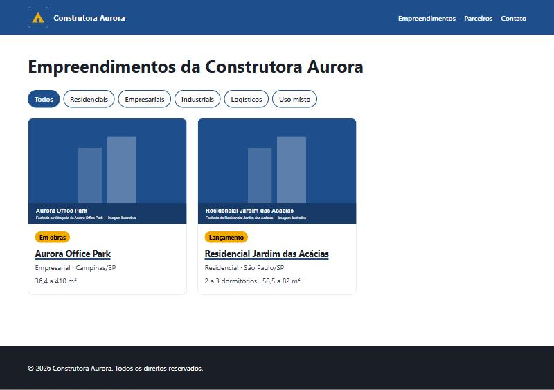
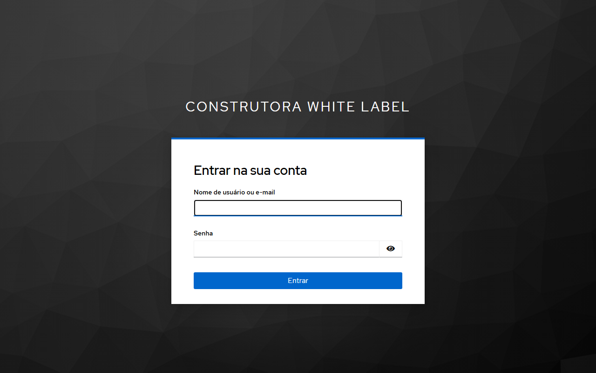

# White Label para construtoras — estudo de caso de engenharia de qualidade

> Vitrine pública de um projeto pessoal, mantida por **Allan Cardoso Messias** (QA Sênior).
> O código-fonte fica em repositório privado. **Acesso completo sob solicitação**, pelo [LinkedIn](https://www.linkedin.com/in/allan-messias-23a16a11b).

Uma única base de código que publica o site de várias construtoras, cada uma com sua marca, seu domínio e seu portfólio de empreendimentos. Construí o projeto com um agente de IA (Claude Code), no papel de dono do produto e responsável pela qualidade: eu defini as regras, o agente escreveu o código, e nada chegou à `main` sem passar pelos testes e pela minha aprovação.

Esta vitrine mostra **como a qualidade foi construída**, não só o resultado.

## Em 30 segundos

Números de 24/11/2026, depois do bloco 09C (pull request #23):

| O quê | Resultado |
|---|---|
| Testes automatizados | **3.597** |
| Formato da pirâmide | 79% unitário · 18% integração · 3% contrato e E2E |
| Mutation score (StrykerJS) | **100%** em seis pacotes (6.007 mutantes mortos) |
| Testes de contrato (Pact) | 57, entre o site, o painel e os serviços |
| E2E (Playwright + axe) | 54 jornadas, **zero** violações graves de acessibilidade; toda semana em 4 navegadores |
| Isolamento entre construtoras | Suíte obrigatória `@isolamento` em todo endpoint com dados de cliente |
| Decisões registradas | 36 ADRs (registros de decisão de arquitetura) |
| Gates no CI | 11, incluindo cobertura, mutação, contratos, acessibilidade e segredos |
| Guardas do repositório | 7 testes que conferem o próprio projeto: pipeline, variáveis de ambiente, rótulos, caracteres invisíveis e esta vitrine |

Esta vitrine é revista a cada bloco, e um teste no pipeline barra o pull request se ela ficar para trás. Veja a [linha do tempo](linha-do-tempo.md).

## O produto

Duas construtoras fictícias, o mesmo código. O domínio decide qual marca aparece, e nada de uma vaza para a outra:

| Construtora Aurora | Construtora Boreal |
|---|---|
|  |  |

Além do site público, já existem:

- o login com perfis (Keycloak) e o painel da plataforma e das construtoras;
- a gestão da equipe com limite de usuários por pacote e o histórico imutável de ações;
- o catálogo para todos os segmentos (residencial, empresarial, industrial e loteamentos), com venda e locação, busca, paginação e importação de unidades por planilha;
- a personalização do site pela própria construtora: identidade visual, textos, contatos, redes e seções, com rascunho, pré-visualização, publicação, histórico e restauração;
- o envio de logo, ícone da aba, capa e imagem de compartilhamento: cada imagem é conferida pelo conteúdo, refeita no servidor sem a localização GPS da foto e fica privada até a publicação;
- as fotos e plantas dos empreendimentos, pelo mesmo caminho seguro, em tamanhos prontos para cada aparelho, e fora do ar quando o empreendimento é despublicado.

Mais telas: página do empreendimento, login e documentação da API

## Meu papel

- **Regras do jogo:** defini as convenções que o agente segue em toda sessão: arquitetura, pirâmide de testes, quality gates, Conventional Commits e o ritual de cada entrega (branch → testes → relatório → PR → merge só com a minha aprovação).
- **Planos antes do código:** cada bloco começou com um plano em linguagem de negócio, aprovado por mim, com as decisões novas destacadas.
- **Estratégia de testes e riscos:** defini os critérios e aprovei a estratégia, os gates e a matriz de riscos que guiam onde testar mais.
- **Sem atalhos:** teste afrouxado, `retry` para esconder instabilidade ou meta rebaixada nunca foram aceitos como solução.

Detalhes em [Trabalho com IA](trabalho-com-ia.md).

## Defeitos que os testes pegaram

Teste bom é o que encontra problema. Alguns exemplos reais:

| Defeito | Quem pegou | O que foi feito |
|---|---|---|
| Dois convites ao mesmo tempo, um em cada cópia do serviço, ocupavam a **última vaga** do pacote duas vezes | Teste de **integração** com duas cópias do serviço no mesmo banco | Trava por construtora. Resposta passou de `[201, 201]` para `[201, 409]`, com uma "prova de sensibilidade" para o teste não perder o poder de detectar a regressão |
| Quem não tinha permissão conseguia ocupar a trava de **outra** construtora antes de ser negado | **Mutação** (mutante sobrevivente) | Teste novo garantindo que o negado nunca toca a trava |
| Um teste antigo convidava pessoas para uma construtora que **não existia**, e passava | **E2E**, depois de uma regra nova | A regra virou 404 sem criar ninguém, e o teste passou a cadastrar a construtora de verdade |
| O E2E abria o histórico antes de o registro assíncrono chegar | **E2E no CI** | O teste passou a respeitar a consistência eventual (até 10 s), sem `sleep` fixo |
| A ficha usada pela edição trazia fotos e plantas só com o endereço público: quem editasse pelo painel **apagaria as imagens** sem perceber | **Desenho da tela de edição**, antes de qualquer uso | A ficha passou a trazer a chave do armazenamento, com testes de regressão unitário e de integração |
| A planilha baixada pelo painel perderia a marca de codificação, e o Excel mostraria as palavras acentuadas com símbolos no lugar dos acentos | **Unitário** do cliente HTTP | Leitura que preserva a marca; o teste falhava antes |
| No pipeline, um segredo chegava vazio ao E2E: o Turborepo só repassa as variáveis da lista, e localmente o teste rodava sem ele | **E2E no CI** | Variável incluída e um **teste-guarda** que confere toda variável lida pela configuração do E2E |
| O link de pré-visualização do site levava o token no caminho da URL: passava do limite do servidor e ficaria nos logs de acesso | **Integração HTTP** | Token num cabeçalho, mascarado nos logs |
| A mutação do painel chegou a 17 de 20 minutos no pipeline | **Aviso de tempo** no próprio pipeline | Bloco curto antes da entrega seguinte, sem cortar nada. [Ver o case](cases/mutacao-no-ci.md) |
| A rodada semanal do E2E nos 4 navegadores passou de 25 minutos e foi cancelada, sem nenhuma falha até ali | **Rodada semanal** | Um job por navegador, em paralelo, com teste-guarda |
| O serviço de construtoras deixaria de subir com o armazenamento de imagens fora do ar, derrubando o site inteiro | **Teste de integração** que sobe o serviço com as dependências desligadas | O armazenamento passou a ser preparado em segundo plano; só o envio de imagem falha até ele voltar |
| O envio de imagens do site passava na máquina local e recebia erro 500 no pipeline: o armazenamento reserva volumes de 30 GB por bucket, e o disco pequeno do CI só comportava o bucket do catálogo | **E2E no CI** | Volumes de 256 MB, um teste de integração com disco limitado a 8 GB que falhava antes da correção e um **teste-guarda** que mantém iguais o armazenamento do pipeline e o dos testes |
| Um teste de privacidade da vitrine garantia que nenhum identificador interno aparecia na resposta, mas usava endereços de imagem fictícios (`teste/fachada.svg`) e nunca pegaria um identificador no endereço | **Revisão do teste** ao trocar as imagens por imagens enviadas de verdade | O endereço da imagem deixou de levar o identificador do empreendimento, e o teste passou a usar imagens reais |
| Mover uma foto com posição negativa tiraria a última foto da galeria e a poria na frente (`splice(-1)` conta do fim) | **Unitário** da galeria, antes de a tela existir | A posição é conferida antes de mexer na lista |
| Um logo horizontal, o formato mais comum, sairia achatado num quadrado de 48 × 48 no topo do site | **Revisão da tela** antes do E2E | Altura fixa e largura pela proporção |
| Esta vitrine ficou quatro blocos sem atualização, porque dependia de alguém lembrar | **Revisão do dono do produto** | A revisão entrou no ritual de cada bloco, com teste-guarda e publicação automática no merge |

## Navegue pela vitrine

| Página | O que tem |
|---|---|
| [Arquitetura](arquitetura.md) | Microsserviços, um banco por serviço, eventos e o diagrama de containers |
| [Qualidade](qualidade.md) | Princípios, pirâmide, quality gates, isolamento entre clientes e matriz de riscos |
| [Amostras de testes](amostras-de-testes.md) | Um exemplo real de cada camada, com o que ele prova |
| [Decisões](decisoes.md) | As decisões de arquitetura mais importantes e o porquê |
| [Trabalho com IA](trabalho-com-ia.md) | Como conduzi o agente e as regras que impedem atalhos |
| [Linha do tempo](linha-do-tempo.md) | Cada bloco entregue, com a data e o destaque de qualidade |
| [Case: mutação no pipeline](cases/mutacao-no-ci.md) | Paramos uma entrega para o pipeline não parar, sem cortar testes |

## Tecnologias

TypeScript em tudo · Node 26 · pnpm + Turborepo · NestJS (Fastify) · Next.js · PostgreSQL + Prisma · RabbitMQ · Keycloak · Traefik · armazenamento S3 · Docker Compose · GitHub Actions.

Testes: Vitest, Testing Library, Testcontainers, Supertest, Pact, Playwright, axe-core, StrykerJS. Análise estática: ESLint, dependency-cruiser, gitleaks, Semgrep, Trivy.
