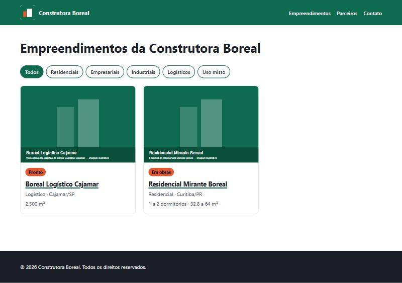
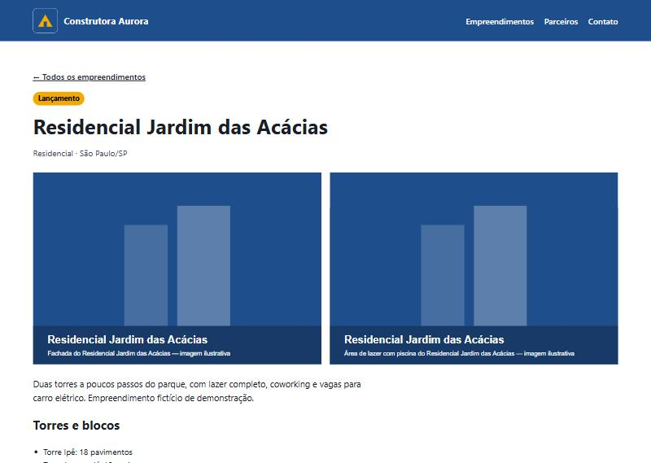
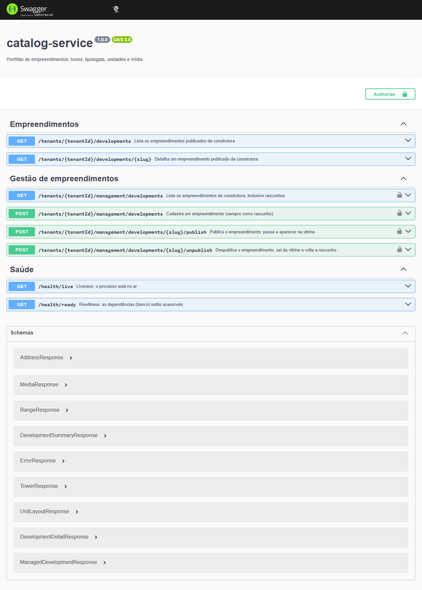

# White Label para construtoras — estudo de caso de engenharia de qualidade

> Vitrine pública de um projeto pessoal, mantida por **Allan Cardoso Messias** (QA Sênior).
> O código-fonte fica em repositório privado. **Acesso completo sob solicitação**, pelo [LinkedIn](https://www.linkedin.com/in/allan-messias-23a16a11b).

Uma única base de código que publica o site de várias construtoras, cada uma com sua marca, seu domínio e seu portfólio de empreendimentos. Construí o projeto com um agente de IA (Claude Code), no papel de dono do produto e responsável pela qualidade: eu defini as regras, o agente escreveu o código, e nada chegou à `main` sem passar pelos testes e pela minha aprovação.

Esta vitrine mostra **como a qualidade foi construída**, não só o resultado.

## Em 30 segundos

Números de 18/11/2026, depois da 10ª entrega (pull request #10):

| O quê | Resultado |
|---|---|
| Testes automatizados | **1.720** |
| Formato da pirâmide | 74% unitário · 22% integração · 4% contrato e E2E |
| Mutation score (StrykerJS) | **100%** em três serviços (1.805 mutantes) |
| Testes de contrato (Pact) | 29 interações entre consumidores e provedores |
| E2E (Playwright + axe) | 40 jornadas, **zero** violações graves de acessibilidade |
| Isolamento entre construtoras | Suíte obrigatória `@isolamento` em todo endpoint com dados de cliente |
| Decisões registradas | 29 ADRs (registros de decisão de arquitetura) |
| Gates no CI | 11, incluindo cobertura, mutação, contratos, acessibilidade e segredos |

## O produto

Duas construtoras fictícias, o mesmo código. O domínio decide qual marca aparece, e nada de uma vaza para a outra:

| Construtora Aurora | Construtora Boreal |
|---|---|
|  |  |

Além do site público, já existem o login com perfis (Keycloak), o painel da plataforma e das construtoras, a gestão da equipe com limite de usuários por pacote e o histórico imutável de ações.

Mais telas: página do empreendimento, login e documentação da API

## Meu papel

- **Regras do jogo:** defini as convenções que o agente segue em toda sessão: arquitetura, pirâmide de testes, quality gates, Conventional Commits e o ritual de cada entrega (branch → testes → relatório → PR → merge só com a minha aprovação).
- **Planos antes do código:** cada bloco começou com um plano em linguagem de negócio, aprovado por mim, com as decisões novas destacadas.
- **Estratégia de testes e riscos:** defini os critérios e aprovei a estratégia, os gates e a matriz de riscos que guiam onde testar mais.
- **Sem atalhos:** teste afrouxado, `retry` para esconder instabilidade ou meta rebaixada nunca foram aceitos como solução.

Detalhes em [Trabalho com IA](trabalho-com-ia.md).

## Defeitos que os testes pegaram

Teste bom é o que encontra problema. Alguns exemplos reais:

| Defeito | Quem pegou | O que foi feito |
|---|---|---|
| Dois convites ao mesmo tempo, um em cada cópia do serviço, ocupavam a **última vaga** do pacote duas vezes | Teste de **integração** com duas cópias do serviço no mesmo banco | Trava por construtora. Resposta passou de `[201, 201]` para `[201, 409]`, com uma "prova de sensibilidade" para o teste não perder o poder de detectar a regressão |
| Quem não tinha permissão conseguia ocupar a trava de **outra** construtora antes de ser negado | **Mutação** (mutante sobrevivente) | Teste novo garantindo que o negado nunca toca a trava |
| Um teste antigo convidava pessoas para uma construtora que **não existia**, e passava | **E2E**, depois de uma regra nova | A regra virou 404 sem criar ninguém, e o teste passou a cadastrar a construtora de verdade |
| O E2E abria o histórico antes de o registro assíncrono chegar | **E2E no CI** | O teste passou a respeitar a consistência eventual (até 10 s), sem `sleep` fixo |

## Navegue pela vitrine

| Página | O que tem |
|---|---|
| [Arquitetura](arquitetura.md) | Microsserviços, um banco por serviço, eventos e o diagrama de containers |
| [Qualidade](qualidade.md) | Princípios, pirâmide, quality gates, isolamento entre clientes e matriz de riscos |
| [Amostras de testes](amostras-de-testes.md) | Um exemplo real de cada camada, com o que ele prova |
| [Decisões](decisoes.md) | As decisões de arquitetura mais importantes e o porquê |
| [Trabalho com IA](trabalho-com-ia.md) | Como conduzi o agente e as regras que impedem atalhos |

## Tecnologias

TypeScript em tudo · Node 26 · pnpm + Turborepo · NestJS (Fastify) · Next.js · PostgreSQL + Prisma · RabbitMQ · Keycloak · Traefik · armazenamento S3 · Docker Compose · GitHub Actions.

Testes: Vitest, Testing Library, Testcontainers, Supertest, Pact, Playwright, axe-core, StrykerJS. Análise estática: ESLint, dependency-cruiser, gitleaks, Semgrep, Trivy.
