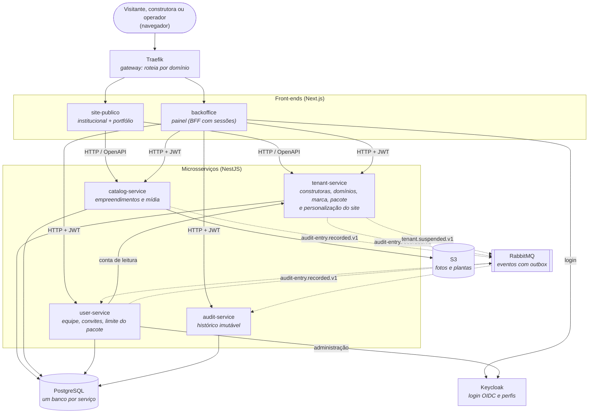

# Arquitetura

[← Voltar ao início](README.md)

Microsserviços por capacidade de negócio, **um banco PostgreSQL por serviço** e comunicação só por contrato: HTTP com OpenAPI ou eventos versionados no RabbitMQ (`<entidade>.<acao>.v<N>`). Nenhum serviço importa código de outro, e o `dependency-cruiser` barra no CI qualquer dependência que fure essa regra.

## O que já está construído



Próximos blocos: envio seguro de imagens, parceiros e canais de venda ("Onde comprar ou alugar"), contatos (leads) com LGPD, ambiente completo em containers e testes de segurança dinâmicos. A situação de cada bloco está na [linha do tempo](linha-do-tempo.md).

## Decisões que moldam a qualidade

| Decisão | Por que importa para a qualidade |
|---|---|
| **Multi-tenant por domínio** | O domínio decide a construtora. Por isso o vazamento entre clientes é o risco nº 1 e tem suíte própria de testes |
| **Arquitetura hexagonal em cada serviço** | O domínio não conhece framework, banco nem HTTP, e é testado com testes unitários rápidos e mutação |
| **Um banco por serviço** | Cada serviço evolui sozinho. Os contratos (Pact) garantem que um não quebra o outro |
| **Eventos com tabela de saída (outbox)** | O evento só sai se a transação gravou. Os testes de integração provam isso com Postgres e RabbitMQ reais |
| **Identidade no Keycloak, tenant no token** | A autorização é testada numa matriz perfil × endpoint, com o Keycloak real nos testes de integração |
| **Custo zero com caminho de migração** | Tudo é open source ou gratuito, e cada decisão registra como migrar para um serviço pago |

## Estrutura de cada serviço

```
services/<servico>/
├── src/
│   ├── domain/          ← regras de negócio puras (objetos de valor, entidades)
│   ├── application/     ← casos de uso; dependem só de portas (interfaces)
│   ├── infrastructure/  ← Prisma, RabbitMQ, S3, clientes HTTP (implementam as portas)
│   └── presentation/    ← controllers HTTP e validação de entrada
└── test/
    ├── integration/     ← Testcontainers + Supertest
    └── contract/        ← Pact (lado provedor)
```

As dependências apontam sempre para dentro: `domain` não importa nada de fora, e isso também é verificado no CI.
